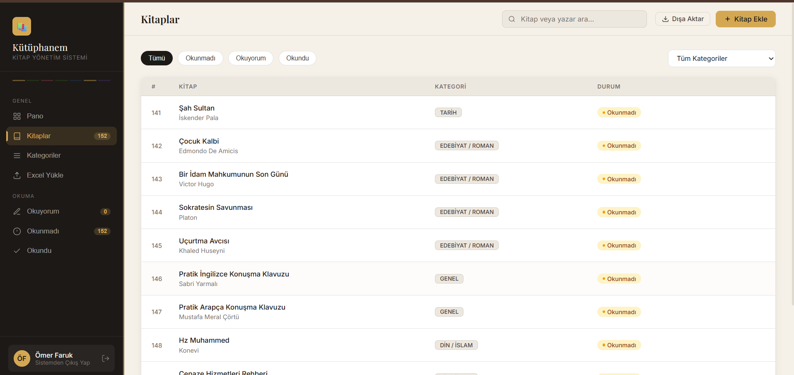
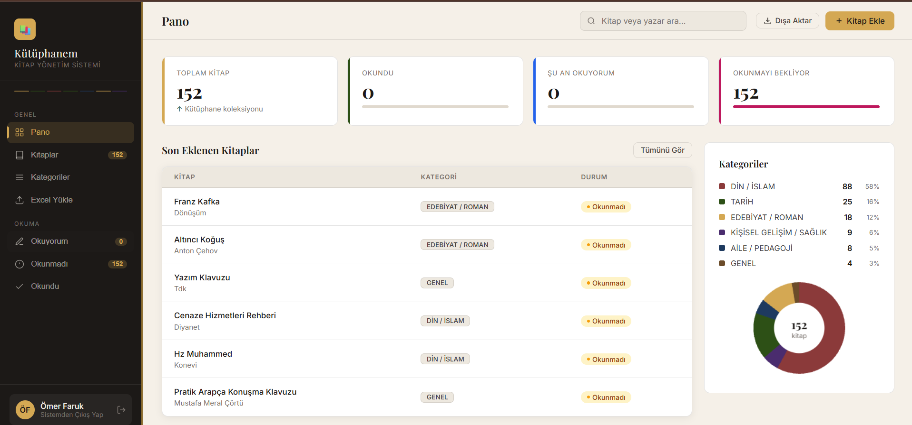
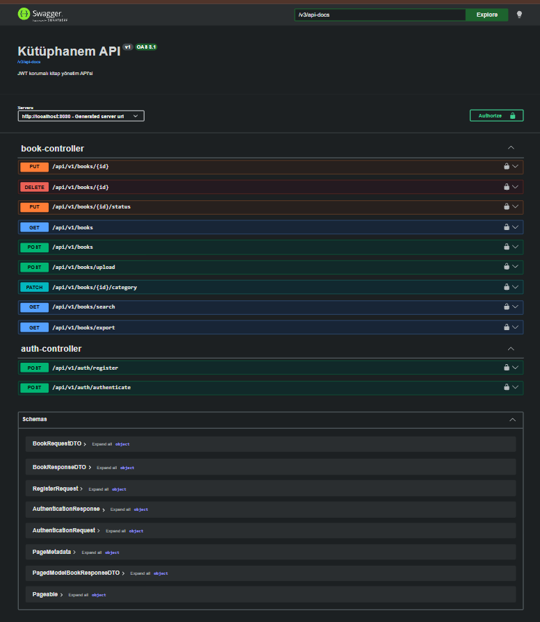

# Kütüphanem API

Evdeki kitapları bir Excel dosyasında tutuyorduk. "Bu kitap bizde var mı?" sorusuna cevap vermek için dosyayı açıp aramak zorunda kalmak, filtrelemenin zahmetli olması ve okuma durumu gibi bilgileri tutamamak bir süre sonra sıkıntı olmaya başladı. Bu proje o Excel dosyasının yerini alıyor: aynı listeyi arayüzden aranabilir hale getiriyor, kitapları yapay zeka ile otomatik kategorilendiriyor ve okuma durumlarını takip ediyor.

Mevcut kütüphanede 150 civarı kitap var ve sistem bu gerçek veriyle çalışıyor.




---

## Ne yapıyor

- **JWT tabanlı kimlik doğrulama**, USER ve ADMIN olmak üzere iki rol
- **Excel toplu içe aktarma**: mevcut listeyi olduğu gibi yükleyebiliyorsun, işlem arka planda asenkron çalışıyor
- **Yapay zeka ile otomatik kategorilendirme**: Google Gemini'ye 10'ar kitaplık gruplar halinde başlık gönderiliyor, 150 kitap için 150 yerine 15 API çağrısı yapılıyor
- **Arama, sayfalama ve sıralama**
- **Okuma durumu takibi** (okunmadı / okunuyor / okundu)
- **Excel dışa aktarma** (Apache POI)
- **Flyway** ile sürümlenmiş veritabanı şeması
- Tek komutla ayağa kalkan **Docker** kurulumu
- - **Swagger UI** ile otomatik API dokümantasyonu, endpoint'ler tarayıcıdan denenebiliyor


---


| Pano | Swagger UI |

|---|---|

|  |  |

## Teknolojiler

| Katman | Kullanılan |
|---|---|
| Dil / Çatı | Java 21, Spring Boot 4.0 |
| Güvenlik | Spring Security, JWT (jjwt) |
| Veri | PostgreSQL 15, Spring Data JPA, Hibernate 7, Flyway |
| Dosya işleme | Apache POI |
| Yapay zeka | Google Gemini API |
| Dokümantasyon | springdoc-openapi (Swagger UI) |
| Paketleme | Docker, docker compose |

---

## Çalıştırma

### Docker ile

```bash
git clone https://github.com/omercse/kutuphanem-api.git
cd kutuphanem-api
cp .env.example .env
# .env dosyasini doldur (asagidaki tabloya bak)
docker compose up --build
```

| | |
|---|---|
| Arayüz | http://localhost:8080 |
| Swagger UI | http://localhost:8080/swagger-ui.html |
| Sağlık kontrolü | http://localhost:8080/actuator/health |

### Yerelde

PostgreSQL'in çalışıyor ve `kutuphane_db` veritabanının oluşturulmuş olması gerekiyor.

```bash
export DB_PASSWORD=... JWT_SECRET=... ADMIN_EMAIL=... ADMIN_PASSWORD=...
./mvnw spring-boot:run
```

---

## Ortam değişkenleri

| Değişken | Zorunlu | Açıklama |
|---|---|---|
| `DB_URL` | hayır | Varsayılan `jdbc:postgresql://localhost:5432/kutuphane_db` |
| `DB_USER` | hayır | Varsayılan `postgres` |
| `DB_PASSWORD` | **evet** | Tanımsızsa uygulama açılmaz |
| `JWT_SECRET` | **evet** | 32 baytlık hex. Üretmek için `openssl rand -hex 32` |
| `JWT_EXPIRATION` | hayır | Milisaniye, varsayılan 24 saat |
| `ADMIN_EMAIL` | hayır | Doluysa açılışta ADMIN oluşturulur |
| `ADMIN_PASSWORD` | hayır | `ADMIN_EMAIL` ile birlikte kullanılır |
| `GEMINI_API_KEY` | hayır | Boşsa AI kategorilendirme devre dışı kalır, kitaplar GENEL olur |

Kodda hiçbir sır tutulmuyor. `DB_PASSWORD` ve `JWT_SECRET` için bilinçli olarak varsayılan değer tanımlanmadı: eksiklerse uygulama sessizce zayıf bir değere düşmek yerine açılışta hata veriyor.

---

## Endpoint'ler

| Metot | Yol | Yetki | Açıklama |
|---|---|---|---|
| POST | `/api/v1/auth/register` | herkes | Kayıt, her zaman USER rolüyle |
| POST | `/api/v1/auth/authenticate` | herkes | Giriş, JWT döner |
| GET | `/api/v1/books` | USER, ADMIN | Sayfalı liste (`?page=&size=&sort=`) |
| GET | `/api/v1/books/search` | USER, ADMIN | `?title=&author=` ile filtreli arama |
| GET | `/api/v1/books/export` | USER, ADMIN | Excel dışa aktarma |
| POST | `/api/v1/books` | ADMIN | Tek kitap ekleme |
| POST | `/api/v1/books/upload` | ADMIN | Excel toplu yükleme (202 döner) |
| PUT | `/api/v1/books/{id}/status` | USER, ADMIN | Okuma durumu güncelleme |
| PUT | `/api/v1/books/{id}` | ADMIN | Kitap güncelleme |
| DELETE | `/api/v1/books/{id}` | ADMIN | Silme |

---

## Tasarım kararları

**Kayıt olan herkes USER.** ADMIN yetkisi `/register` üzerinden verilemiyor, çünkü o endpoint kimlik doğrulama istemiyor; aksi halde API adresini bilen herkes silme yetkisi kazanırdı. İlk ADMIN, sunucuya erişimi olan kişinin tanımladığı `ADMIN_EMAIL` ve `ADMIN_PASSWORD` değişkenleriyle açılışta oluşuyor. Sistemde zaten bir ADMIN varsa hiçbir şey yapılmıyor; bu yüzden şifre değişkenini sonradan değiştirmek mevcut hesabın şifresini güncellemez.

**Şemayı Flyway yönetiyor, Hibernate değil.** `ddl-auto` `validate` olarak ayarlı: Hibernate açılışta entity sınıflarıyla gerçek şemayı karşılaştırıyor, uyuşmazlık varsa uygulama başlamıyor. Şema değişiklikleri `src/main/resources/db/migration` altında sürümlenmiş SQL dosyaları olarak duruyor.

**N+1 sorgu önlemi.** `Book` ile `Author` ve `Category` arasındaki `@ManyToOne` ilişkiler LAZY; liste sorgularında `@EntityGraph` ile tek JOIN'e indiriliyor. `spring.jpa.open-in-view` bilinçli olarak kapalı, aksi halde lazy loading sorunları görünmez hale geliyor.

**Yapay zeka çağrıları gruplanıyor.** Her kitap için ayrı istek atmak yerine 10'ar başlık tek prompt'ta gönderiliyor. 150 kitaplık liste için 15 çağrı yetiyor.

**Okuma durumu enum.** Daha önce serbest metindi ve geçerli değerler servis katmanında bir listeyle kontrol ediliyordu. `BookStatus` enum'ına çevrildi, veritabanında da CHECK kısıtı var.

---

## Bilinen eksikler

- Excel içe aktarma 202 dönüyor ama işin durumunu sorgulayacak bir endpoint yok; başarısız olursa kullanıcı öğrenemiyor
- Gemini çağrılarında istek aralığı sabit bekleme ile yönetiliyor, exponential backoff yok
- Test kapsamı düşük; entegrasyon testleri Testcontainers'a taşınacak
- Arama, JPA Specification yerine elle yazılmış JPQL kullanıyor
- Token yenileme (refresh token) ve çıkış mekanizması yok

---

## Lisans

MIT
